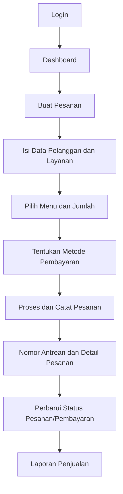

<div align="center">

# SimBaRa 🌯
**Aplikasi Manajemen Operasional dan Penjualan Kebab Ceria**

*Kelola pesanan, antrean, pembayaran, dan performa usaha dalam satu tempat.*


</div>

---

## Tentang SimBaRa

**SimBaRa** adalah rancangan aplikasi manajemen operasional untuk **Kebab Ceria** yang berfokus pada pencatatan pesanan, pengelolaan antrean, pemantauan status pembayaran, dan penyajian laporan penjualan. Aplikasi ini dirancang untuk membantu aktivitas operasional kedai menjadi lebih terstruktur, mudah dipantau, dan tidak bergantung pada pencatatan yang tersebar.

Melalui satu antarmuka, pengguna dapat melihat ringkasan aktivitas kedai, membuat dan memproses pesanan, memantau transaksi, serta meninjau performa penjualan berdasarkan periode tertentu.

## Tujuan Pengembangan

- Membantu proses pencatatan pesanan pelanggan agar lebih rapi dan terpusat.
- Mempermudah pemantauan nomor antrean dan detail pesanan.
- Menyediakan pencatatan metode serta status pembayaran.
- Menyajikan ringkasan penjualan untuk mendukung pemantauan usaha.
- Membantu pemilik usaha dan staf memahami kondisi operasional kedai.

## Pengguna Sistem

| Role | Tanggung Jawab |
|---|---|
| **Admin** | Mengelola operasional aplikasi, data pesanan, laporan, serta pengaturan sistem. |
| **Kasir** | Membuat pesanan, mencatat detail transaksi, memilih metode pembayaran, dan memproses pesanan. |
| **Pemilik Usaha** | Memantau aktivitas kedai, ringkasan penjualan, dan laporan performa usaha. |

> Hak akses akhir dapat disesuaikan dengan implementasi autentikasi dan kebutuhan operasional Kebab Ceria.

## Fitur Utama

### 1. Dashboard Operasional

Dashboard dirancang untuk menampilkan gambaran aktivitas kedai secara ringkas, seperti antrean aktif, pelanggan, informasi promo, dan ringkasan kas harian.

### 2. Pengelolaan Pesanan

- Membuat pesanan baru berdasarkan nama pelanggan.
- Memilih kanal layanan, seperti pesanan melalui WhatsApp atau pembelian langsung (*direct*).
- Menentukan kebutuhan meja atau opsi pengambilan pesanan.
- Menambahkan menu dan jumlah item ke dalam pesanan.
- Menampilkan ringkasan item dan total pembayaran.

### 3. Nomor Antrean dan Detail Pesanan

Pencatatan antrean membantu staf mengenali urutan pesanan yang sedang diproses. Detail pesanan menyajikan informasi item, total transaksi, dan status pesanan sehingga proses pelayanan lebih mudah dipantau.

### 4. Pencatatan Pembayaran

Sistem menyediakan pilihan metode pembayaran **Cash** dan **QRIS**, beserta informasi status transaksi. Pada tingkat prototype, fitur ini menjelaskan pencatatan metode dan status pembayaran; integrasi ke payment gateway atau verifikasi transaksi otomatis perlu dikonfirmasi secara terpisah.

### 5. Laporan Penjualan dan Keuangan

Informasi penjualan dirancang agar dapat ditinjau berdasarkan beberapa periode:

- **Harian:** omzet, grafik penjualan, menu terlaris, dan histori pembayaran.
- **Bulanan:** ringkasan performa dan tren penjualan dalam satu bulan.
- **Tahunan:** ringkasan penjualan tahunan dan performa kasir.
- **Keseluruhan (*all-time*):** gambaran akumulasi penjualan selama data tersedia.

### 6. Pengaturan Akun

Pengguna dapat mengakses pengaturan akun, seperti pengelolaan profil, perubahan kata sandi, konfigurasi harga satuan, dan preferensi sistem sesuai hak akses.

## Alur Penggunaan



## Teknologi dan Tools

| Teknologi / Tool | Penggunaan |
|---|---|
| **HTML5** | Struktur halaman antarmuka web. |
| **CSS3** | Styling, layout, dan tampilan responsif. |
| **JavaScript** | Interaksi dan perilaku antarmuka. |
| **Figma** | Perancangan UI/UX dan prototype antarmuka. |

> Daftar ini menggambarkan teknologi dan tools yang digunakan dalam proses perancangan serta penyusunan frontend project. Backend, database, dan layanan eksternal tidak dicantumkan sebagai teknologi yang sudah terintegrasi karena status implementasinya belum diverifikasi pada paket project ini.

## Struktur Project

Struktur folder dapat berbeda mengikuti versi project. Contoh susunan frontend yang disarankan:

```text
SimBara-Kebab-Ceria/
├── index.html
├── assets/
│   ├── images/
│   └── icons/
├── css/
│   └── style.css
├── js/
│   └── script.js
└── README.md
```

Gunakan struktur aktual project saat melakukan commit. Nama file dan folder pada contoh di atas perlu disesuaikan apabila berbeda.

## Menjalankan Project

Untuk mencoba versi frontend statis:

1. Clone atau unduh repository.
2. Ekstrak folder project apabila diunduh dalam bentuk ZIP.
3. Buka folder project melalui Visual Studio Code.
4. Jalankan file halaman utama (`index.html`) melalui browser atau gunakan ekstensi **Live Server**.
5. Navigasikan halaman dan coba alur yang tersedia pada prototype.

Jika project menggunakan asset atau library eksternal, pastikan koneksi internet tersedia dan seluruh path asset tetap sesuai dengan struktur folder.

## Progress Pengembangan

| Area | Progress / Keterangan |
|---|---|
| Perancangan UI/UX | Prototype antarmuka dirancang menggunakan Figma. |
| Frontend | Hasil rancangan telah disusun dalam folder project berbasis HTML. |
| Alur pemesanan | Alur input pelanggan, pilihan layanan, menu, dan pembayaran telah dirancang. |
| Antrean dan transaksi | Kebutuhan tampilan nomor antrean, detail pesanan, dan status transaksi telah dirancang. |
| Laporan | Rancangan laporan penjualan harian, bulanan, dan tahunan tersedia dalam cakupan sistem. |
| Dokumentasi | Panduan penggunaan SimBara telah disusun untuk membantu pengguna memahami alur aplikasi. |

### Pengembangan Berikutnya

- [ ] Memastikan seluruh interaksi frontend berjalan konsisten.
- [ ] Menyelesaikan pengujian usability dengan pengguna kasir dan pemilik usaha.
- [ ] Merancang dan mengintegrasikan backend serta database.
- [ ] Menerapkan autentikasi dan pembatasan hak akses berbasis role.
- [ ] Menghubungkan transaksi dengan pencatatan data yang persisten.
- [ ] Mengintegrasikan payment gateway apabila dibutuhkan.
- [ ] Melakukan pengujian fungsional dan keamanan.
- [ ] Melakukan deployment agar aplikasi dapat diakses secara online.

## Dokumentasi

Panduan penggunaan sistem tersedia pada dokumen **Guidebook SimBara Admin**. Dokumen tersebut menjelaskan penggunaan login, dashboard, pembuatan pesanan, metode pembayaran, laporan, pengaturan akun, serta penanganan masalah.

## Catatan Project

SimBaRa dikembangkan sebagai solusi digital untuk mendukung pengelolaan operasional Kebab Ceria. README ini mendokumentasikan tujuan, cakupan fitur, rancangan alur, dan progres yang telah diketahui. Status integrasi backend, database, payment gateway, serta deployment harus diperbarui setelah implementasi dan pengujiannya benar-benar selesai.

---

<div align="center">

**SimBaRa — Make Every Order Easier to Manage.**

*Designed for Kebab Ceria.*

</div>
